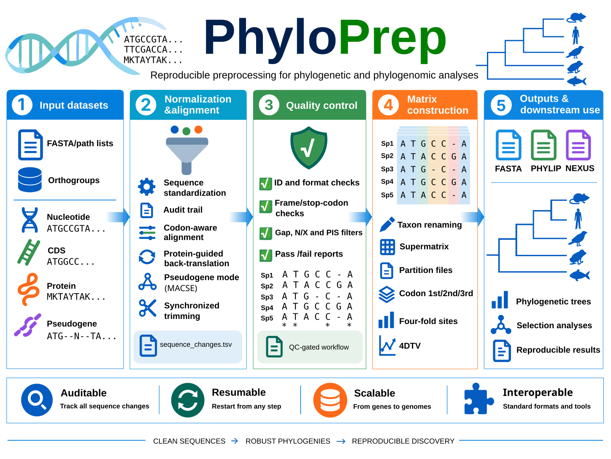
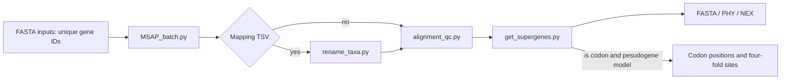
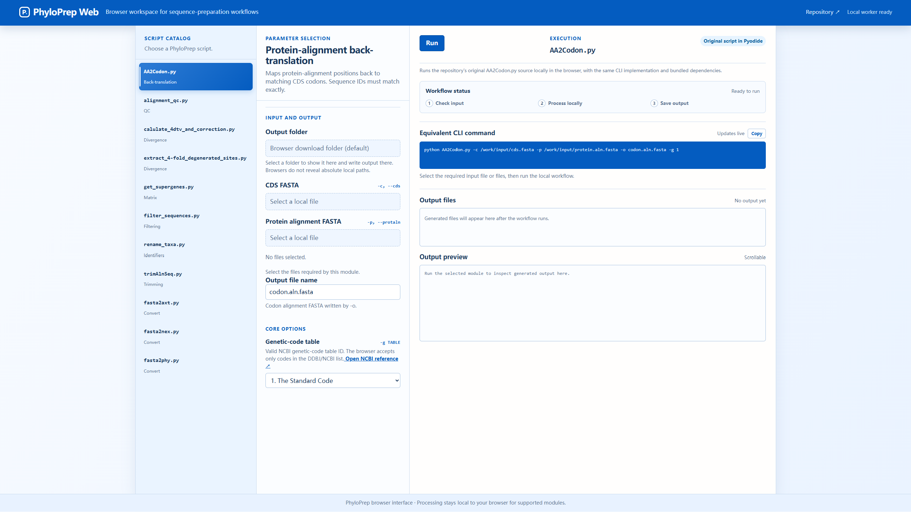

# **PhyloPrep: an auditable command-line application for phylogenomic matrix preparation**

PhyloPrep prepares nucleotide, CDS, protein, and pseudogene alignments for phylogenetic analysis. It includes a complete workflow (`phyloprep.py`) and standalone utilities for alignment, QC, concatenation, format conversion, trimming, taxon renaming, four-fold-site extraction, and 4DTV.



## Contents

1. [PhyloPrep Web](#phyloprep-web)
2. [Install](#install)
3. [Quick start](#quick-start)
4. [Input modes and normalization](#input-modes-and-normalization)
5. [Complete workflow](#complete-workflow)
6. [Outputs and audit reports](#outputs-and-audit-reports)
7. [Script reference](#script-reference)
8. [QC and tree building](#qc-and-tree-building)
9. [Divergence statistics: 4DTV and related values](#divergence-statistics-4dtv-and-related-values)
10. [PhyloPrep Web](#PhyloPrep-Web)
11. [Testing and troubleshooting](#testing-and-troubleshooting)

## Install

Required: Python >=3.8, Biopython, and one aligner (MAFFT is the default). Linux/POSIX is required for safe batch locking and publication.

Optional: MUSCLE, PRANK, ClustalW2, trimAl, and Java plus[ `macse_v2.07.jar`](https://www.agap-ge2pop.org/wp-content/uploads/macse/releases/macse_v2.07.jar) for pseudogene mode.

```bash
conda create -n phyloprep python=3.11 biopython mafft
conda activate phyloprep
conda install -c bioconda muscle prank clustalw trimal
git clone git@github.com:thecgs/PhyloPrep.git
```

### Singularity / Apptainer

`Singularity.def` obtains the Ubuntu 22.04 base image from Singularity Library, then installs Python 3.11, Biopython, MAFFT, MUSCLE 5, PRANK, ClustalW2, trimAl, Java and OrthoFinder 2.5.5. The image provides OrthoFinder's bundled DIAMOND, MCL and FastME binaries, plus FastTree and IQ-TREE from Bioconda for its tree-inference methods and NCBI BLAST+ for OrthoFinder DNA (`-d`) input. It downloads MACSE v2.07 from the [official MACSE release URL](https://www.agap-ge2pop.org/wp-content/uploads/macse/releases/macse_v2.07.jar) and verifies its SHA-256 digest. Network access is required for Singularity Library, Conda and MACSE.

`build_singularity.sh` locates the repository automatically before invoking Singularity, so it can be called from any working directory. The output path is interpreted from the directory in which the command is run:

```bash
cd /path/to/example
sudo ../build_singularity.sh phyloprep.sif
```

The image entry point is `phyloprep.py`; the current directory is normally available inside the container, so input and result paths can remain relative:

```bash
singularity run phyloprep.sif -i genes.pathlist -st codon -j 8 -t 1 -o results

# Run OrthoFinder in the same image when required.
singularity exec phyloprep.sif orthofinder -f proteomes -t 16 -a 4
```

Run from this directory or add it to `PATH`. Use `python SCRIPT.py --help` for the installed command definition.

## Quick start

```bash
# Complete CDS workflow
python phyloprep.py -i genes.pathlist -st codon -t 4 -j 2 -o results

# Rename taxa after alignment
python phyloprep.py -i genes.pathlist -m taxa.tsv -st codon -o results

# Protein workflow without trimming
python phyloprep.py -i proteins.fa -st prot --notrim -o protein-results

# Frameshift/stop-tolerant pseudogene workflow
python phyloprep.py -i pseudo.pathlist -st pseudogene \
  --macse-jar macse_v2.07.jar -j 2 -o pseudo-results
```

## Containerized examples

Two end-to-end, Singularity/Apptainer-based examples are available: a mitochondrial CDS workflow and a nuclear single-copy ortholog workflow that includes reference-genome download, longest-transcript selection, OrthoFinder, and PhyloPrep. See the step-by-step [tutorial](TUTORIAL.md). ` phyloprep.sif` image and complete example data will be released through Zenodo, DOI: https://doi.org/10.5281/zenodo.22949440.

## Input modes and normalization

Inputs are FASTA. IDs must be unique within a file; alignment tools require at least two non-empty sequences. A path-list contains one FASTA path per line; blank lines and lines beginning `#` or `;` are ignored. Relative references are resolved from the list directory (existing working-directory references are also accepted). Existing absolute paths are used directly. If a referenced path is missing, PhyloPrep checks for its basename beside the list, allowing an exported folder to be moved between machines. Missing references produce an error naming the list and entry.

| `-st` mode | Input requirement | Standardization |
| --- | --- | --- |
| `nucl` | DNA or RNA | `U` becomes `T`; `R/Y/S/W/K/M/B/D/H/V/?` become `N`. |
| `codon` | Ungapped CDS; a trailing 1–2-base excess is trimmed | Same nucleotide rules; terminal stops are removed and internal stops become `NNN`; trailing excess bases are audited. |
| `prot` | Protein sequences | Selected trailing stop symbol is removed; internal stops and `B/Z/J/O/U/?` become `X`. |
| `pseudogene` | Ungapped DNA in coding orientation | MACSE handles stops and frameshifts; standardized NT/AA outputs use `N`/`X`. |

Original input files are never changed. Each replacement is recorded in `sequence_changes.tsv`. Coordinates are 1-based inclusive. Use `--protein-stop-symbol .` (alias `--stop-symbol .`) for dot-encoded protein stops.

## Complete workflow

`phyloprep.py` is the recommended command. It runs `MSAP_batch.py` using the original, unique gene IDs, optionally renames all raw and trimmed alignment matrices, performs provenance-aware QC, concatenates passing genes, splits codon positions, extracts four-fold sites, and exports FASTA, relaxed PHYLIP, and NEXUS. Downstream QC consumes the validated `alignments/path-lists/all.*.pathlist` manifests written by `MSAP_batch.py`; it does not reconstruct alignment paths from filenames. This prevents stale outputs from failed or newly skipped loci from re-entering a later matrix build. In `codon` and `pseudogene` workflows, codon and protein alignments are treated as paired representations of the same locus: trimming preserves a shared site mask, structural 3-nt:1-aa correspondence is validated, independent supermatrices retain each representation's own QC-passing loci, and additional paired supermatrices use a shared retained locus set.

The following project diagram shows how the executable scripts connect. It is
also useful as a reference when running any component independently.




| Important option | Purpose |
| --- | --- |
| `-i FASTA|LIST ...` | FASTAs, path lists, or both. |
| `-o DIR` | Pipeline directory; default `phyloprep-results`. |
| `-m TSV` | Two-column gene-ID/taxon-ID mapping applied after MSA and before QC/concatenation. |
| `-st` | `codon`, `nucl`, `prot`, or `pseudogene`. |
| `-t N`, `-j N` | MAFFT/MUSCLE threads and concurrent jobs. |
| `--missing-taxa` | `skip-gene` or `pad-gaps` during concatenation. |
| `--min-length`, `--max-*-ratio` | Representation-specific QC thresholds. Independent matrices use each side's own QC and PIS threshold. Additional paired matrices require both sides to pass non-PIS QC, then apply `--paired-pis-policy`. |
| `--allow-internal-stop` | Retain a protein locus or paired codon/protein locus when an internal stop is observed directly or recorded by preprocessing as masked to `NNN/X`. The masked state is not restored. |
| `--paired-pis-policy` | `both` (default), `either`, `codon`, or `protein`; controls how paired codon/protein PIS decisions are combined while keeping the final locus set identical in both matrices. |
| `--min-nucl-pis`, `--min-protein-pis` | Per-locus nucleotide/amino-acid PIS thresholds, each defaulting to 0. Nucleotide applies to nucl/codon/pseudogene; protein applies to prot/codon/pseudogene. Both independent and paired matrices use these thresholds. |
| `-g TABLE` | NCBI genetic-code table; default 1. |
| `--macse-jar`, `--macse-memory` | Pseudogene MACSE settings. |

`--trimal-args` forwards remaining arguments to trimAl and must be the final option. In codon and pseudogene modes, PhyloPrep runs trimAl on the paired protein alignment, obtains its retained protein columns, and transfers them to complete codon triplets; users must not pass trimAl's `-in`, `-out`, `-fasta`, `-backtrans`, or `-colnumbering` options because PhyloPrep manages them. Pseudogene workflows retain other matrices if no four-fold sites remain, writing `fourfold.skipped.txt`.

The complete workflow automatically removes terminal stops from CDS and protein inputs and records them in the audit report. Removed terminal stops do not fail QC. `phyloprep.py` does not accept `--allow-terminal-stop`; unexpected directly observed stops in normal codon/protein outputs still fail QC. Pseudogene workflows retain their internal stop/frameshift-tolerant policy. The option is available only in standalone `alignment_qc.py` for externally supplied alignments; it permits an observed terminal stop without modifying the sequence. `--allow-internal-stop` remains available in the complete workflow to control retention of audited masked internal stops.

### Live progress

`MSAP_batch.py` reports completed/total loci, completed/skipped/failed counts, elapsed time and an estimated remaining time. Updates are flushed immediately after a locus finishes, with a throttled heartbeat while jobs are running. Failed and cancelled runs are labelled accordingly; completed-task counts are not a success guarantee.

`phyloprep.py` reports alignment, raw/trimmed QC and matrix preparation, dataset export, and publication. Stage counts describe completed stages, not a percentage of compute time. Long-running CLI subprocesses refresh elapsed time periodically. Browser batch workflows update locus counts and elapsed time live; Python QC/matrix stages stream progress to the browser and the interface refreshes elapsed time while a stage runs. Pipeline results return a metadata-only file manifest; contents are transferred separately in acknowledged 1 MiB chunks, avoiding a single JSON containing every output. Output browsing places `phyloprep-run.json` first, followed by `reports/`, `matrices/`, `qc/`, and other files. Folder filters, filename search, and 200-file pages keep very large result sets responsive. Filtering and pagination do not remove outputs or change save-all/download-all behavior. Previews are capped while downloads remain complete. Download links remain valid for the page lifetime and are reused for retries; they are not revoked after a one-second timeout. Where supported, saving directly to a chosen file writes ZIP parts sequentially to reduce archive memory peaks. Selecting an output folder also allows saving all current results there without rebuilding a ZIP. ZIP32 size/count limits are checked explicitly; oversized archives should be saved as individual files to a folder. Browser download requests are labelled as requested, not falsely reported as completed. This reduces serialization peaks but does not eliminate the memory required for alignment or retained browser output. ETA is an estimate based on completed loci and can be inaccurate for heterogeneous or resumed inputs. Progress reporting uses Python's standard library, with the existing browser's native JavaScript APIs for display and no additional progress dependencies.

## Outputs and audit reports

```text
results/
  renamed/<type>/<raw|trimmed>/    # passing matrices after -m ID mapping
  alignments/                      # batch products and checkpoints
  reports/sequence_changes.tsv     # merged provenance report
  qc/<type>/<raw|trimmed>/          # representation-specific pass, fail, and details TSVs
  qc/paired/<raw|trimmed>/           # paired decisions + codon/prot.retained.tsv manifests
  matrices/
    codon/<raw|trimmed>/            # supermatrix, codon1st/2nd/3rd, fourfold
    prot/<raw|trimmed>/             # independent protein supermatrix
    paired/<codon|prot>/<raw|trimmed>/ # additional shared-locus matrices
    nucl/<raw|trimmed>/             # nucleotide supermatrix
    pseudogene/<codon|prot>/<raw|trimmed>/
    pseudogene/paired/<codon|prot>/<raw|trimmed>/
```

Every final matrix has `.fasta`, `.phy`, and `.nex` products. Concatenation also creates gene-inclusion reports and partition files for PartitionFinder and IQ-TREE. The complete workflow defers PHYLIP export until the format-conversion stage (`get_supergenes.py --no-phylip`), avoiding duplicate supermatrix conversion. Standalone concatenation still writes PHYLIP by default. Publication is staged, so failed processing does not publish partial matrices.

Sequence-change reports include `input_kind` to distinguish source sequences from native MACSE alignments even when a source filename resembles an intermediate product. Browser and CLI matrix groups are staged and published only after every requested raw/trimmed representation succeeds.

## Script reference

### `phyloprep.py` — complete workflow

Use for routine phylogenomic preparation. It accepts all batch options plus mapping and QC options.

```bash
python phyloprep.py -i genes.pathlist -m taxa.tsv -st codon -t 4 -j 2 -o results
```

`-m/--mapping` is deliberately applied **after** MSA and **before** QC. This
lets each orthogroup contain unique gene IDs during alignment, then assesses
the renamed taxon matrices during QC before species-supermatrix construction.
The mapping contents and file signature are captured together before alignment; a changed mapping aborts renaming rather than publishing or checkpointing stale IDs.
Renaming is resumable: an unchanged source alignment, mapping file,
`rename_taxa.py`, and renamed FASTA are skipped on a later run.
Use `--no-resume` to force this step as well as MSAP batch alignment to rerun.

When `-m` is omitted, PhyloPrep attempts concatenation using the original IDs.
If no loci share a consistent taxon set, it stops after retaining
`reports/concatenation/<type>/<raw|trimmed>/original_ids.report.tsv` and tells
the user to supply a mapping. Mapping cannot make an all-copies orthogroup into
a species matrix: if two genes in one alignment map to the same taxon, QC marks
that matrix as `duplicate_ids` and the pipeline stops before concatenation. Keep
those gene IDs and use per-orthogroup gene trees with ASTRAL-Pro3 or another
duplication-aware method.

### `MSAP.py` — single-gene alignment

Aligns one gene. Codon mode translates, aligns protein, and back-translates; pseudogene mode uses MACSE.

```bash
python MSAP.py -i CDS.fa -st codon -g 1 -t 4
python MSAP.py -i proteins.fa -st prot --protein-stop-symbol .
python MSAP.py -i pseudo.fa -st pseudogene --macse-jar macse_v2.07.jar
```

Outputs use `GENE.ALIGNER.{nucl|prot|codon}[.trimmed].aln`; audit reports are retained. In codon mode, default trimming uses one shared site mask for the paired protein and back-translated codon alignments. For each amino-acid/codon site, gap, codon-N, and protein-X fractions are evaluated together; if any selected threshold rejects the site, the amino-acid column and its complete codon triplet are removed together. trimAl codon mode likewise transfers retained protein columns to complete codon triplets.
Trimmed FASTA alignments always end in `.trimmed.aln`, for both trimming programs and all sequence types (including MACSE outputs). Batch path lists use `all.TYPE.trimmed.aln.pathlist`. Raw alignments retain `.aln`.

### `MSAP_batch.py` — concurrent, resumable alignment

Runs `MSAP.py` for multiple FASTAs. `-j` controls concurrent jobs and `-t` controls MAFFT/MUSCLE threads per job. Use `--no-resume` to force recomputation.

```bash
python MSAP_batch.py -i gene1.fa gene2.fa -st nucl -j 4 -o msap-results
```

It writes validated alignments, checkpoints, reports, and current path lists under `path-lists/`.

### `alignment_qc.py` — matrix QC

Checks IDs, lengths, gap/N/X ratios, PIS, codon frame/stops, and optional PhyloPrep preprocessing provenance. It writes `PREFIX.pass.tsv`, `PREFIX.fail.tsv`, and `PREFIX.details.tsv`.

```bash
# Direct inspection of an alignment
python alignment_qc.py -i alignments.pathlist -st codon -p qc/codon \
  --max-n-ratio 0.2 --min-nucl-pis 20

# Provenance-aware inspection of MSAP/PhyloPrep products
python alignment_qc.py -i alignments.pathlist -st codon -p qc/codon \
  --sequence-changes reports/sequence_changes.tsv
```

Codon gaps must be complete triplets (`---`). Without `--sequence-changes`, stop control is based on stops directly observable in the supplied alignment: genetic-code-aware stop codons for `codon`, and `*` for `prot`. With one or more `--sequence-changes TSV` reports, QC also recovers stop events that MSAP already standardized before alignment:

- **Internal stop:** MSAP replaces the codon with `NNN`; the paired protein representation carries the corresponding standardized uncertainty. The audit row remains an `internal_stop` event. `alignment_qc.py` therefore marks both the codon representation and the paired protein representation as containing an audited internal stop. The locus fails by default. `--allow-internal-stop` permits the locus, but the sequence remains masked; it never restores the original stop codon or `*`.
- **Terminal stop removed by MSAP:** a normal complete-CDS terminal stop is deleted before translation and recorded as `terminal_stop`. This is reported in the audited-stop columns but **does not fail QC**.
- **Stop still present in a supplied alignment:** a definite codon stop or protein `*` is an observed alignment feature and fails by default. `--allow-terminal-stop` permits a terminal stop and `--allow-internal-stop` permits internal stops. Custom protein stop symbols should be normalized before standalone QC.

The detailed report separates directly observed stop information from `Audited_terminal_stop` and `Audited_internal_stop`, so a masked source event is not misrepresented as a stop that still exists in the final alignment.

In the complete `phyloprep.py -st codon` workflow the merged `reports/sequence_changes.tsv` is supplied automatically. The same audited internal-stop decision is applied to both codon and protein representations. Pseudogene mode is different by design: MACSE stop/frameshift events are masked and reported, but those events do not by themselves reject the pseudogene pair.

### `get_supergenes.py` — supermatrix and partitions

Concatenates aligned genes and writes `PREFIX.fasta`, `PREFIX.phy`, a report, and partition files. `skip-gene` excludes incomplete loci; `pad-gaps` retains them with gaps.

```bash
python get_supergenes.py -i qc/alignment.pass.tsv -p matrices/supermatrix --missing-taxa pad-gaps
```

### `split_codon_seqence_alignment.py` — codon-position matrices

Splits one codon alignment into `codon1st.`, `codon2nd.`, and `codon3rd.` FASTAs in the working directory.

```bash
python split_codon_seqence_alignment.py -i supermatrix.fasta
```

### `extract_4-fold_degenerated_sites.py` — four-fold sites

Retains third positions only if all taxa have valid matching four-fold codons. Ambiguity and gaps exclude a site.

```bash
python extract_4-fold_degenerated_sites.py -i supermatrix.fasta -o fourfold.fasta -g 1
```

### `AA2Codon.py` — protein-to-codon back-translation

Maps each non-gap protein position to its matching CDS codon. IDs must match exactly. `-g` validates translations.

```bash
python AA2Codon.py -c CDS.fa -p protein.aln.fa -o codon.aln.fa -g 1
```

### `trimAlnSeq.py` — threshold trimming

Trims nucleotide/protein sites or whole codon triplets using gap and N/X ratios. `-ra` removes invariant sites. `-i -` reads stdin; no `-o` writes stdout. Zero retained sites is an error.

```bash
python trimAlnSeq.py -i gene.aln.fa -o gene.trimmed.aln -st codon -G 0.2 -N 0.2
```

### `filter_sequences.py` — taxon filtering

Filters complete sequences by length, gap/N/X ratios, and keep/remove taxon lists; then removes all-missing columns.

```bash
python filter_sequences.py -i alignment.fa -o retained.fa -st prot --max-x-ratio 0.1 --keep-taxa taxa.txt
```

### `rename_taxa.py` — FASTA ID renaming

Reads a two-column tab-separated mapping and applies OrthoFinder result-label substitutions: `:`, `,`, `(` and `)` become `_`. FASTA IDs cannot contain whitespace. `--keep-special` remains only as a deprecated compatibility flag and does not disable those substitutions.

```bash
python rename_taxa.py -i input.fa -o renamed.fa -m taxa.tsv --map-output applied.tsv
```

### `extract_orthofinder_orthogroups.py` — OrthoFinder orthogroup sequence extraction

Reads OrthoFinder `Orthogroups.tsv` with the standard-library `csv` module and writes one FASTA per retained orthogroup. `-i`, `-f`, and `--sequence-dir` are equivalent and accept a sequence directory following OrthoFinder `-f` conventions: one FASTA per taxon, with the filename stem exactly matching an `Orthogroups.tsv` taxon column. It accepts `.fa`, `.faa`, `.fasta`, `.fas`, and `.pep`. The directory may contain either CDS or protein sequences; select `phyloprep.py -st codon` or `-st prot` to match it.

```bash
# Strict one-to-one orthogroups across all retained taxa (default)
python extract_orthofinder_orthogroups.py \
  -og Results/Orthogroups/Orthogroups.tsv -f cds/ \
  --keep-taxa Human Mouse Zebrafish -o one_to_one_cds

# Retain a single-copy OG when at least 8 selected taxa are present
python extract_orthofinder_orthogroups.py \
  -og Orthogroups.tsv -f cds/ --min-taxa 8 -X -o occupancy8_cds

# Preserve every paralogous copy for gene trees used with ASTRAL-Pro3
python extract_orthofinder_orthogroups.py \
  -og Orthogroups.tsv -f proteins/ --copy-mode all-copies --min-taxa 8 \
  -o astralpro_gene_sets
```

| Option or mode | Occupied taxon definition | Written sequences | Intended use |
| --- | --- | --- | --- |
| `--copy-mode single-copy` (default) | The OG cell contains exactly one gene. | One gene for each occupied taxon. | Concatenation, conventional one-to-one species-tree workflows. |
| `--copy-mode all-copies` | The OG cell contains one or more genes. | Every listed gene, including paralogs. | Per-OG gene trees followed by ASTRAL-Pro3 or another duplication-aware method. |

`--min-taxa` is evaluated under the selected mode. Its upper bound is the number of taxa remaining after `--keep-taxa` and `--drop-taxa`; omitting it requires every selected taxon to meet the mode definition. Both taxon options accept names or a one-name-per-line text file and may be combined. An overlap—for example `--keep-taxa Human Mouse --drop-taxa Mouse`—is an error.

The extractor automatically recognizes the `Orthogroups.tsv` ID convention. `Taxon_geneID` is treated as ordinary OrthoFinder output; source FASTA lookup removes that one prefix. Unprefixed `geneID` is treated as OrthoFinder `-X` output and is used directly for lookup. Input style detection controls lookup only: without extractor `-X`, exported IDs are always `Taxon_geneID`; with `-X`, exported IDs are always `geneID`. Existing table prefixes are not added twice. Sequence content and locus selection are unchanged by `-X`; `map.tsv` always uses the actual exported IDs. If different taxa share a gene ID, default taxon prefixes keep them distinct, while `-X` rejects duplicate IDs within an orthogroup and IDs that map to different taxa across orthogroups. A table mixing both forms is rejected; `--orthofinder-id-style prefixed|unprefixed` is available for a deliberately nonstandard converted table. `OUTDIR/map.tsv` is written as unheaded `FASTA_ID<TAB>Taxa` rows for every exported sequence; its first column always exactly matches the FASTA ID, so it can be supplied directly to `phyloprep.py -m` with or without `-X`. Use `--map-output FILE` to choose another path. `OUTDIR/orthogroups.pathlist` contains one absolute path for every FASTA actually exported after filtering, so it can be supplied directly to `phyloprep.py -i`. The sequence IDs in this directory must match the IDs used to produce `Orthogroups.tsv` after OrthoFinder-compatible normalization.

```bash
python phyloprep.py -i one_to_one_cds/orthogroups.pathlist -st codon -o phyloprep_results
```

### Orthology-result adapters — shared orthogroup input standard

`extract_orthofinder_orthogroups.py` consumes a tab-separated table whose first column is `Orthogroup`, whose remaining columns are taxa, and whose cells contain zero or more comma-separated gene IDs. This is OrthoFinder `Orthogroups.tsv` format. The following dependency-free adapters convert common equivalent outputs to that table; then use the extractor exactly as for OrthoFinder.

| Source software | Adapter | Accepted source result | Notes |
| --- | --- | --- | --- |
| OrthoFinder | No conversion | `Orthogroups.tsv` or an appropriate HOG-level TSV | Pass directly to the extractor. |
| Proteinortho | `proteinortho_to_orthogroups.py` | `.proteinortho` or `.poff` table | Reads its three metadata columns and FASTA-file taxon columns. |
| SonicParanoid / SonicParanoid2 | `sonicparanoid_to_orthogroups.py` | `flat.ortholog_groups.tsv` | Reads `group_id` plus FASTA-file taxon columns. |
| OrthoMCL | `orthomcl_to_orthogroups.py` | `groups.txt` | Parses `GROUP: taxon|gene ...` records. |
| OMA Standalone | `oma_to_orthogroups.py` | `Output/OrthologousGroups.txt` | Parses its tab-separated group and member rows. |

```bash
# Proteinortho -> standard table -> orthogroup FASTAs
python proteinortho_to_orthogroups.py \
  -i results.proteinortho -o proteinortho.orthogroups.tsv
python extract_orthofinder_orthogroups.py \
  -og proteinortho.orthogroups.tsv -f cds/ --min-taxa 8 -o proteinortho_cds

# SonicParanoid / SonicParanoid2
python sonicparanoid_to_orthogroups.py \
  -i flat.ortholog_groups.tsv -o sonic.orthogroups.tsv
python extract_orthofinder_orthogroups.py -og sonic.orthogroups.tsv -f cds/ -o sonic_cds

# OrthoMCL and OMA labels normally take the form Taxon|GeneID.
# Strip Taxon| only when CDS FASTA IDs are GeneID rather than Taxon|GeneID.
python orthomcl_to_orthogroups.py -i groups.txt -o orthomcl.orthogroups.tsv \
  --strip-taxon-prefix
python oma_to_orthogroups.py -i Output/OrthologousGroups.txt -o oma.orthogroups.tsv \
  --strip-taxon-prefix
```

The adapters do not infer or change orthology relationships. They only preserve group membership, taxon identity, and all comma-separated copies in a common table. Before extraction, ensure the resulting table IDs and input FASTA IDs are identical after the OrthoFinder-compatible substitutions used by `rename_taxa.py`.

### `fasta2phy.py`, `fasta2nex.py`, `fasta2axt.py` — format conversion

All protect input/output/report paths from collision. DNA ambiguity becomes `N`; protein ambiguity becomes `X`; edits write an adjacent audit TSV or the path passed to `--changes-report`.

```bash
python fasta2phy.py -i matrix.fa -o matrix.phy -st DNA
python fasta2nex.py -i proteins.fa -o proteins.nex -st protein
python fasta2axt.py -i pairwise.fa -o pairwise.axt -st DNA
```

`fasta2axt.py` requires exactly two aligned records. `fasta2nex.py` also supports `-st RNA` and round-trip validates its NEXUS output.

### `calulate_4dtv_and_correction.py` — raw and corrected 4DTV

Calculates raw and HKY-corrected 4DTV for exactly two-sequence codon alignments. This is a maintained analysis tool, not a legacy-only utility. It accepts FASTAs, path lists, or a mixture of both, and writes one row per pairwise alignment.

```bash
python calulate_4dtv_and_correction.py -i pairwise.pathlist -o 4dtv.tsv -g 1
```

Its TSV columns are described in the [4DTV section](#divergence-statistics-4dtv-and-related-values).

### `sequence_audit.py` and `msap_io.py` — internal libraries

These are imported by workflow scripts. They implement normalization, MACSE provenance, report merging, FASTA/path-list validation, stop-codon logic, atomic writes, and output-path protection.

## QC and tree building

### Paired codon/protein QC

For `-st codon`, the protein alignment and its back-translated codon alignment are two representations of the same locus, with separately filtered independent matrices and additional shared-locus paired matrices. Their structural correspondence is established upstream when `AA2Codon.py` back-translates the protein alignment and when paired trimming writes codon/protein outputs from one shared site mask. `phyloprep.py` therefore does not repeat those construction checks during downstream paired QC.

Paired matrices are intended for comparing phylogenetic results from nucleotide and amino-acid data while holding the locus set constant. For example, independent filtering might retain 100 loci for codon data but only 80 for protein data. Differences between the resulting trees could then reflect both sequence representation and locus composition. Joint filtering produces codon and protein matrices from the same retained loci, reducing the influence of locus-set differences on that comparison. It does not guarantee a more accurate tree or imply that paired matrices are preferable for every analysis; independent matrices remain useful when each representation should retain all loci passing its own thresholds.

Translation does not make the two QC decisions identical. Synonymous substitutions can produce informative nucleotide columns without informative amino-acid columns, and ambiguous nucleotides can translate into `X`, changing the representation-specific uncertainty ratio. The non-PIS checks and the selected `--paired-pis-policy` together determine which loci enter both paired matrices.

Here, pairing refers to codon versus protein within each `raw` or `trimmed` branch. Raw and trimmed data are filtered separately and may retain different loci because trimming changes alignment length, uncertainty ratios, and PIS. A controlled comparison of trimming effects would additionally require matching the retained locus sets across these branches; the default paired outputs do not enforce that constraint.

Paired QC operates only on filtering policy: all non-PIS QC requirements must pass for both representations, while PIS is calculated separately for codon and protein because synonymous substitutions can make the two values differ legitimately.

PIS thresholds are applied to each locus before concatenation, not to the total PIS of the final supermatrix. There are two independent options, each defaulting to `0` (PIS filtering disabled):

| Option | Workflow modes | Counted sites |
| --- | --- | --- |
| `--min-nucl-pis` | `nucl`, `codon`, `pseudogene` | Informative nucleotide columns, including nucleotide columns within codon alignments |
| `--min-protein-pis` | `prot`, `codon`, `pseudogene` | Informative amino-acid columns |

For example, `--min-nucl-pis 30 --min-protein-pis 5` in codon mode sets nucleotide PIS >=30 and protein PIS >=5. Omitting one option leaves that threshold at 0; neither threshold inherits from the other. Both thresholds apply to independent matrices and to the PIS decisions combined for paired matrices. Raw and trimmed alignments are assessed separately. An option for an unavailable representation is rejected, including an explicitly supplied zero: `--min-protein-pis` is invalid in `nucl` mode, and `--min-nucl-pis` is invalid in `prot` mode. Standalone `alignment_qc.py` uses the same options for its supported `nucl`, `codon`, and `prot` modes.

The former global PIS option and codon-specific PIS option have been removed. Existing commands must use the corresponding nucleotide and/or protein option; there is no global fallback or short global alias.

The user decides how PIS controls pair retention with `--paired-pis-policy`:

- `both` (default): codon PIS **and** protein PIS must each reach their threshold;
- `either`: codon PIS **or** protein PIS may reach its threshold;
- `codon`: only codon PIS controls the pair;
- `protein`: only protein PIS controls the pair.

Use `--min-nucl-pis` and/or `--min-protein-pis` to set separate thresholds for nucleotide and amino-acid columns. Both default to 0. A zero threshold disables filtering for that representation. The policy controls only the additional paired matrices under `matrices/paired/<codon|prot>/<raw|trimmed>/`: a retained pair is written to both representations. Independent matrices remain under `matrices/<codon|prot>/<raw|trimmed>/` and use each representation's own non-PIS QC and PIS threshold. These datasets include all independently passing loci, not only unmatched loci. The shared decision is reported in `qc/paired/<raw|trimmed>/loci.details.tsv`, including codon PIS, protein PIS, both thresholds, selected policy, PIS status, and final paired status. Representation-specific `alignment.pass.tsv`, `alignment.fail.tsv`, and `alignment.details.tsv` remain untouched and describe each representation on its own. Paired matrix construction uses `qc/paired/<raw|trimmed>/codon.retained.tsv` and `prot.retained.tsv`. Independent construction uses `qc/<codon|prot>/<raw|trimmed>/independent.retained.tsv`. QC statistics are computed once; identical retained sets reuse the completed matrix products. An empty selection writes `skipped.txt` for that dataset without discarding other passing datasets.

Internal-stop provenance is also pair-level. An internal stop recorded by codon preprocessing causes both representations to fail unless `--allow-internal-stop` is supplied. Allowing it changes only the retention policy; the standardized `NNN/X` state and the audit record are preserved. Protein-only PhyloPrep workflows also pass sequence-change provenance into QC; standalone `alignment_qc.py -st prot --sequence-changes ...` applies the same policy explicitly. Nucleotide (`nucl`) QC ignores stop provenance.

PIS (Parsimony-Informative-Sites) counts only resolved states. `N`, `X`, gaps, stops, and other unknown states do not contribute. Codon PIS counts nucleotide alignment columns whereas protein PIS counts amino-acid columns, so their absolute values and appropriate thresholds need not be equal. A zero-PIS matrix can be read by IQ-TREE but does not inform topology; use `--min-nucl-pis` or `--min-protein-pis` to enforce a project-specific per-locus threshold.

There is no universal minimum PIS for taxa. Evaluate PIS with alignment length, missing data, bootstrap support, gene concordance, and the biological divergence of the sample. Use the same NCBI genetic code in downstream codon analyses.

## Divergence statistics: 4DTV and related values

`calulate_4dtv_and_correction.py` estimates sequence divergence from four-fold degenerate codon positions. It expects **exactly two taxa per input alignment**; for a multi-taxon codon matrix, first create pairwise alignments or export each pair into its own FASTA. The same `-g/--genetic-code` used for codon preparation must be supplied here.

```bash
# One pairwise codon alignment
python calulate_4dtv_and_correction.py -i speciesA_speciesB.codon.fa \
  -o species_pairs.4dtv.tsv -g 1

# A list of pairwise alignments
python calulate_4dtv_and_correction.py -i pairwise.pathlist -o all.4dtv.tsv -g 1
```

| Output column | Meaning | Interpretation |
| --- | --- | --- |
| `Input file prefix` | Source alignment basename | Identifies the pair/locus. |
| `Sequence1 name`, `Sequence2 name` | FASTA IDs | Pairwise taxon labels. |
| `raw_4dtv` | Fraction of eligible four-fold sites that are transversions | Direct observed divergence summary. |
| `corrected_4dtv` | HKY-corrected transversion divergence | Attempts to account for multiple substitutions and base composition. |
| `fourfold_sites_total_number` | Eligible comparable four-fold sites | Effective sample size for both estimates. |
| `fourfold_sites_transversion_number` | Observed transversions among eligible sites | Numerator of `raw_4dtv`. |

The program writes `NA` for corrected or raw values when no eligible sites exist, or when the correction is mathematically undefined. Do not compare noisy 4DTV estimates with very small `fourfold_sites_total_number`; report that count beside every estimate. Four-fold sites are useful for broad divergence summaries, but they are not guaranteed neutral in every lineage or genomic compartment. Other values already produced by this repository should be interpreted together with 4DTV rather than replaced by it:

| Value | Produced by | Use |
| --- | --- | --- |
| Alignment length | `alignment_qc.py` | Amount of homologous sequence retained. |
| Gap ratio | `alignment_qc.py` | Alignment completeness and indel burden. |
| N ratio / X ratio | `alignment_qc.py` | Fraction masked as unknown in nucleotide/protein matrices. |
| Variable sites | `alignment_qc.py` | Overall observed sequence variation. |
| PIS | `alignment_qc.py` | Topology-informing variation for tree inference. |
| Distinct site patterns | `alignment_qc.py` | Pattern diversity after masking and gaps. |
| Singleton sites | `alignment_qc.py` | Variation observed in only one taxon. |
| Constant sites | `alignment_qc.py` | Conserved portion of the aligned matrix. |
| Four-fold-site count | `extract_4-fold_degenerated_sites.py` and 4DTV TSV | Informative denominator for synonymous-site analyses. |

For species comparisons, report at least matrix length, gap/N/X ratios, PIS, and four-fold-site count together with raw/corrected 4DTV. For phylogenetic inference, assess bootstrap or other branch-support values in the tree-building program as a separate measure of relationship confidence.

## PhyloPrep Web



[PhyloPrep Web](https://thecgs.github.io/PhyloPrep/) is a client-side browser workspace for the most commonly used PhyloPrep preparation steps. Sequence files stay in the browser for supported workflows; the site downloads Pyodide and Biowasm runtime assets but does not upload the user's sequence data to a PhyloPrep server.

The current browser catalog exposes 19 tools/workflows, including the complete browser-adapted `phyloprep.py` pipeline, `MSAP_batch.py`, OrthoFinder extraction and orthology-result adapters, QC/filtering, matrix construction, codon-position/four-fold utilities, and format conversion. The single-locus `MSAP.py` entry is intentionally hidden because `MSAP_batch.py` supersedes it for browser-facing use; `MSAP.py` remains bundled internally as the batch implementation. Likewise, `orthogroup_table.py` remains an internal shared dependency and is not shown as a standalone web tool.

Browser alignment uses MAFFT E-INS-i 7.520 through Biowasm by default; MUSCLE 5.1.0 remains available for explicit selection. Biowasm does not expose the upstream MAFFT shell wrapper as `mafft.js`; the browser MAFFT option therefore runs the compiled `tbfast` + `dvtditr` E-INS-i pipeline directly. It is intentionally labeled as MAFFT E-INS-i and should not be treated as equivalent to CLI `mafft --auto`. PRANK, ClustalW2, trimAl, MACSE and pseudogene mode remain CLI-only because they rely on external executables, Java, or process-management facilities that are not reproduced by the static GitHub Pages application.

Selecting a browser `.pathlist` automatically displays its reference count and recorded folders, and prompts for directory authorization when the referenced FASTAs are not already selected. Recorded paths may belong to another machine; authorize the current FASTA folder if the data were moved. For browser pathlists, select the `.pathlist` and authorize its input folder with **Select pathlist input folder**, or select its referenced FASTA files as well. The browser cannot read sibling files from a pathlist alone. Only listed FASTAs are used; missing paths fall back to same-folder basenames, and missing or ambiguous references are reported. Folder authorization is read-only; browsers without the directory-picker API use folder-file selection. RUN limits simultaneous file reads to four, and preflight samples up to 100 FASTAs while reporting the resolved input count. Large datasets still require sufficient browser memory. Long sequences can exhaust the alignment runtime even with few taxa. MUSCLE allocation failures produce a readable message with the original diagnostic; use the native CLI for such datasets, or explicitly try browser MAFFT. PhyloPrep does not automatically switch aligners. The Biowasm MUSCLE banner reports a fixed 100 MB RAM value and a build-platform label; these do not measure the host computer.

The browser interface includes tool search/category grouping, context-aware parameter display, basic input preflight checks, local output-folder support where the browser allows it, cancellable MAFFT/MUSCLE execution, and direct workflow handoff for common upstream chains such as Proteinortho/OMA/OrthoMCL/SonicParanoid → orthogroup extraction → PhyloPrep. Every successful browser run also writes `phyloprep-run.json`, containing the selected module, parameters, equivalent CLI command, runtime provenance, and SHA256 hashes for browser inputs and outputs.

The browser implementation distinguishes original-script execution from browser-adapted orchestration. Standalone Python utilities run their repository source directly in Pyodide. Higher-level workflows use a compatibility layer to replace Linux child-process/concurrency behavior while keeping the underlying PhyloPrep sequence-processing modules unchanged. Browser `phyloprep.py` uses the same provenance-aware paired codon/protein QC as the CLI, and browser `alignment_qc.py` accepts an optional `sequence_changes.tsv` file for the same audited-stop logic.

## Testing and troubleshooting

Before release:

```bash
python -m pytest -q
python -m compileall -q .
git diff --check
```

| Problem | Action |
| --- | --- |
| CDS has a trailing 1–2-base excess | `codon` trims it with a warning and `terminal_partial_codon` audit event. Internal frameshifts require `pseudogene`. |
| No alignments pass QC | Inspect `alignment.details.tsv` and `reports/sequence_changes.tsv`. If loci are rejected for internal stops, verify `-g` matches the source CDS (e.g. table 2 for vertebrate mitochondria). Correct a wrong table and rerun from original CDS; allowing internal stops does not undo masking. Otherwise inspect rejection reasons and revise justified thresholds. |
| No four-fold matrix | Candidate sites were removed by ambiguity, gaps, or incompatible codon prefixes. |
| MACSE fails | Check Java, `--macse-jar`, and a valid memory value such as `2g`. |
| Output-path conflict | Use distinct input, output, and `--changes-report` paths. |
| Batch unexpectedly resumes | Add `--no-resume` after confirming recomputation is intended. |
